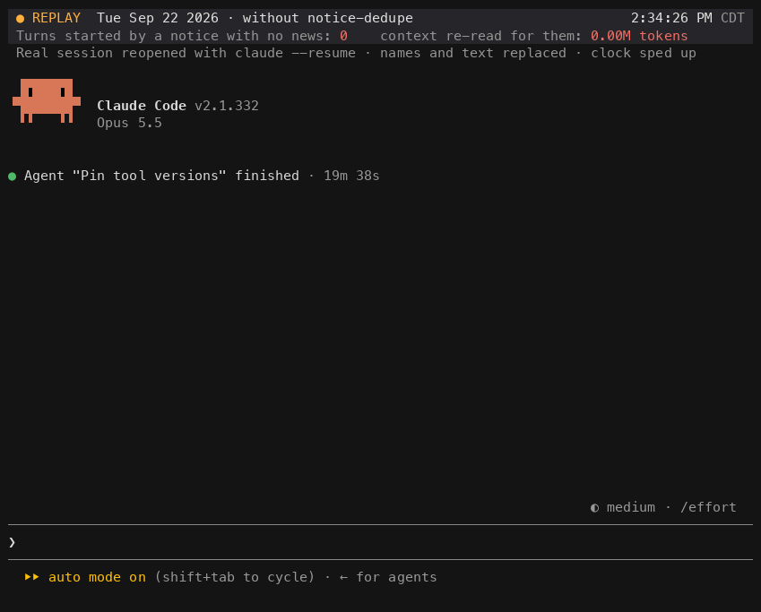
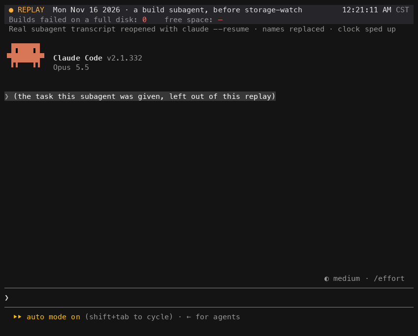

# ryk-claude-mods

Claude Code mods for long sessions that run many subagents and background jobs. A mod is a Claude Code plugin built on TypeScript hook modules: code that Claude Code loads and runs on its own events (a tool call, a turn ending, a compaction). Each mod is a separate plugin in the `ryk-claude-mods` marketplace, so you can install any of them on their own.

**Status:** personal tools, version 0.x. Options and behaviour may change between versions.

## Why

In a long session the main thread (the conversation you type into) hands work to subagents (helper agents it starts, each with its own context) and to background jobs. A few things go wrong as that grows:

- Context fills up. Every step re-reads the whole conversation, so a large context makes each step slow and costly, and compaction (Claude Code summarizing the conversation to free space) can drop the goal or the constraints you set.
- Work gets lost between agents. A subagent that runs out of room needs to leave a handoff (a short written brief of the goal, state and next steps) for whoever continues, and branches and worktrees pile up with no record of which agent made them.
- Noise wakes the main thread. Repeated or empty task notifications each cost a turn.
- The machine runs out. Many agents, Docker containers and builds at once can exhaust memory or disk.

Each mod handles one of these.

## Requirements

- Claude Code 2.1.330 or later. The mods were built against 2.1.330 and tested on 2.1.331; older versions may lack parts of the hook API they use.
- mem-watch and storage-watch run on macOS and Linux. mem-watch reads `memory_pressure` and `sysctl` on macOS and `/proc/meminfo` on Linux; storage-watch reads `df` on the macOS data volume, or `/` elsewhere. On another OS mem-watch has no reading: it says so once, its status line stays empty and its memory gate stays open, but its agent and job caps still apply. The other mods run wherever Claude Code does.

### Defaults that change behaviour

A few defaults act even when nothing is wrong. Change them with the mod's options, for example in `settings.json`: `"pluginConfigs": { "mem-watch@ryk-claude-mods": { "options": { "maxConcurrentAgents": 8 } } }`.

- **mem-watch caps every session at 4 top-level agents and 3 background jobs at once**, whatever memory says. A fifth subagent or fourth `run_in_background` job is refused until one finishes. Set `maxConcurrentAgents` or `maxBackgroundJobs` (0 turns a cap off).
- **mem-watch's swap limit is the size of physical memory** unless `maxSwapGb` is set above 0. Its free-memory limit (`minFreePercent` 28) was tuned on a 24 GB Mac.
- **agent-budget appends one sentence to every spawned agent's prompt** (`addRuleToSpawns`, on by default), telling it to follow an `[agent-budget]` note. Turn it off to leave prompts untouched; agents may then ignore the note.

## Install

Add the marketplace:

```sh
claude plugin marketplace add RyanKim17920/ryk-claude-mods
```

Or clone it and add the local folder:

```sh
git clone https://github.com/RyanKim17920/ryk-claude-mods.git ~/.claude/ryk-claude-mods
claude plugin marketplace add ~/.claude/ryk-claude-mods
```

Install one mod:

```sh
claude plugin install notice-dedupe@ryk-claude-mods
```

Install all of them:

```sh
for m in notice-dedupe agent-budget branch-owners focus-compact goal-refresh mem-watch storage-watch; do
  claude plugin install "$m@ryk-claude-mods"
done
```

Or add the marketplace and install a mod in one step:

```sh
claude plugin install notice-dedupe --marketplace RyanKim17920/ryk-claude-mods
```

`install` takes `--scope user|project|local` (default `user`).

Update (with a local clone, run `git -C ~/.claude/ryk-claude-mods pull` first):

```sh
claude plugin marketplace update ryk-claude-mods
claude plugin update notice-dedupe@ryk-claude-mods
```

Restart Claude Code to load an update. Each mod's options are in its README and can be set with `claude plugin configure <mod>@ryk-claude-mods` or in `/plugin`.

## Mods

<table>
<tr><th align="left">Mod</th><th align="left">What it does</th></tr>
<tr><td valign="top"><a href="notice-dedupe/README.md">notice-dedupe</a></td><td>Stops task notifications and messages with no news from waking the main thread: empty "report delivered" notices and near-exact repeats. Counts what it drops.</td></tr>
<tr><td colspan="2" align="center"></td></tr>
<tr><td valign="top"><a href="agent-budget/README.md">agent-budget</a></td><td>Tracks each agent's context size and warns as it grows. Past the threshold, a subagent is told to write its handoff brief and stop, and main is compacted in place. Every step re-reads the agent's whole context, so past the budget a fresh agent takes over from a short handoff and each step stays small.</td></tr>
<tr><td colspan="2" align="center"></td></tr>
<tr><td valign="top"><a href="branch-owners/README.md">branch-owners</a></td><td>Records which agent created each git branch and worktree. <code>/branch-owners</code> lists the unmerged branches with their owners.</td></tr>
<tr><td colspan="2" align="center"></td></tr>
<tr><td valign="top"><a href="focus-compact/README.md">focus-compact</a></td><td>Gives every compaction a standing focus and keeps each summary as a brief on disk. Asks a subagent to hand off when compaction stops shrinking its context.</td></tr>
<tr><td colspan="2" align="center"></td></tr>
<tr><td valign="top"><a href="goal-refresh/README.md">goal-refresh</a></td><td>Keeps a long session working toward the exact goal you set. It re-sends the session's standing goal (and the native <code>/goal</code> condition) to Claude every 10 turns, every 20 minutes and after each compaction, on turns already happening. The goal can be changed by talking it over, and it is also pinned under the prompt.</td></tr>
<tr><td colspan="2" align="center"></td></tr>
<tr><td valign="top"><a href="mem-watch/README.md">mem-watch</a></td><td>Watches free memory and swap (macOS and Linux), shows them in the status line and alerts once when either crosses its limit, naming the top memory users. While over, only light commands (reading, inspecting, file chores, everyday git, stopping, cleanup) run. Whatever memory says, it caps each session at 4 top-level subagents (their own children are not capped) and 3 background jobs at once.</td></tr>
<tr><td colspan="2" align="center"></td></tr>
<tr><td valign="top"><a href="storage-watch/README.md">storage-watch</a></td><td>Watches free disk space, shows it in the status line and alerts as it falls through each tier (20, 10, 5, 1 GB), naming the biggest space users. At or below 5 GB only light commands and cleanup run, and tree copies (<code>cp -r</code>) are refused.</td></tr>
<tr><td colspan="2" align="center"></td></tr>
</table>

Each clip is a short walkthrough built from real recorded sessions. Captions and highlights are added, and terminal text is cropped but never edited. For storage-watch and branch-owners, the clip compares runs without and with the mod. Where a clip used a scaled-down limit, it says so on screen.
